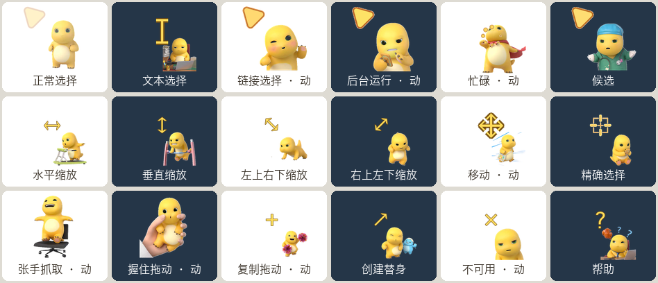

# 奶龙鼠标指针主题 · Nailoong Cursor Theme

把奶龙（Nailoong）做成 macOS 鼠标指针的 MaCursor 主题包。基于奶龙**官方发布**的动画贴纸素材重制，共 18 个语义状态，其中 8 个是逐帧动画。



> 动画效果见 [`previews/官方动作扩展版-动画预览.gif`](previews/官方动作扩展版-动画预览.gif)

## 特性

- **18 个语义状态**全部覆盖：正常选择、文本选择、链接选择、后台运行、忙碌、候选、精确选择、移动、四向缩放、抓取/拖动/复制、创建替身、不可用、帮助
- **HiDPI 三档图层**：32 / 64 / 160 px，对应 1× / 2× / 5× 屏幕
- **8 个逐帧动画**：移动（24 帧）、张手抓取（26 帧）、握住拖动（21 帧）、复制拖动（21 帧）、不可用（11 帧）、忙碌（12 帧）等
- **热点已逐个校准**：箭头类状态热点压在尖端 `(2.5, 2.5)`，不会出现「点不准」的偏移
- 无脚本、无后台进程，纯静态资源文件

## 安装

前置：[MaCursor](https://apps.apple.com/app/id6463074807)（macOS 13+，免费）

1. 下载 [`themes/奶龙鼠标指针-官方动作扩展版-v2.2.cursor`](themes/奶龙鼠标指针-官方动作扩展版-v2.2.cursor)
2. **双击**文件，MaCursor 会自动导入并出现在资源库
3. 在 MaCursor 里选中该主题，点「应用」

想恢复系统指针：MaCursor 内选「系统默认」。

## 三个版本，该选哪个

| 版本 | 状态数 | 体积 | 特点 | 适合 |
|---|---|---|---|---|
| **官方动作扩展版 v2.2** | 18 | 8.2 MB | 全状态 + 8 组动画，官方贴纸 512px 原图 | 日常主力（推荐） |
| 官方高清动图版 | 12 | 4.7 MB | 只做常用状态，动画更克制 | 觉得满屏动画太闹 |
| 公开素材版 | 11 | 320 KB | 静态图，来源是公开商品图 | 只想尝鲜／体积敏感 |

版本演进说明见 [`docs/版本说明.md`](docs/版本说明.md)。

## 分享给别人

最省事的方式——**把 `.cursor` 文件直接发过去**（微信/邮件/AirDrop 都行），对方双击即可导入：

```text
themes/奶龙鼠标指针-官方动作扩展版-v2.2.cursor
```

要求只有两条：macOS 13 或更高、装了 MaCursor。Windows 用不了。

如果对方不想装 App，建议改成发预览图，或者把 GIF 发过去让他看看效果。

## 项目结构

```text
.
├── themes/          # 可直接导入的 .cursor 主题（发布产物）
├── previews/        # 状态预览图与动画 GIF
├── docs/
│   ├── 素材来源-*.md   # 每个版本逐帧的原始素材出处
│   └── 版本说明.md     # 4 次迭代做了什么改动
└── tools/
    ├── inspect_cursor.py   # 查看主题结构（状态/帧数/热点/图层）
    └── extract_frames.py   # 导出全部帧为 PNG，便于改图
```

## 工具脚本

纯 Python 标准库，无需安装依赖。

```bash
# 看看这个主题里到底有什么
python3 tools/inspect_cursor.py "themes/奶龙鼠标指针-官方动作扩展版-v2.2.cursor"

# 把所有帧导出成 PNG（想替换美术素材时用这个）
python3 tools/extract_frames.py "themes/奶龙鼠标指针-官方动作扩展版-v2.2.cursor" -o ./frames
```

## 技术说明

`.cursor` 不是二进制格式，是 **plist XML**：每个状态对应一个 `com.apple.cursor.N` 或 `com.apple.coregraphics.*` 键，记录 `FrameCount`、`FrameDuration`、`HotSpotX/Y`、`PointsWide/High`，图片以 base64 PNG 内嵌在 `Representations` 数组里（数组每项是一个分辨率图层）。所以可以直接用 Python 的 `plistlib` 读写，不需要任何私有工具。这也是 `tools/` 下两个脚本能做出来的原因。

## 版权与致谢

- 角色与美术素材版权归 **奶龙 / 第七印象文化** 所有。本仓库是**非商业的同人适配**，仅做裁切、缩放、去底、设置热点等格式转换，未创作新美术内容。
- 各版本的素材出处逐条记录在 [`docs/`](docs/) 里，可追溯。
- 如果权利方认为不妥，提 issue 或联系仓库所有者，会立即下架。
- `tools/` 下的脚本以 MIT 协议发布；该协议**不覆盖** `themes/` 与 `previews/` 中的图像素材。
